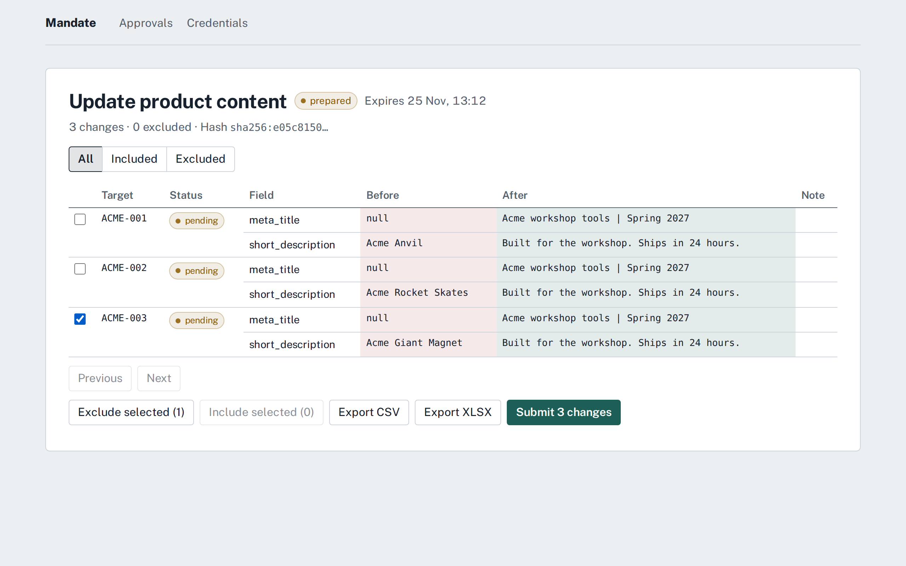
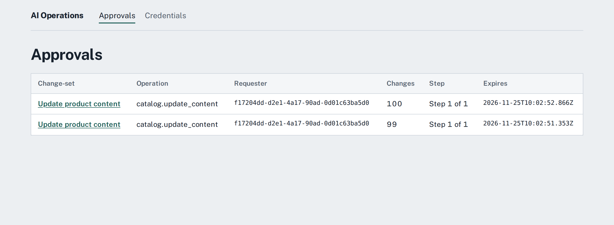
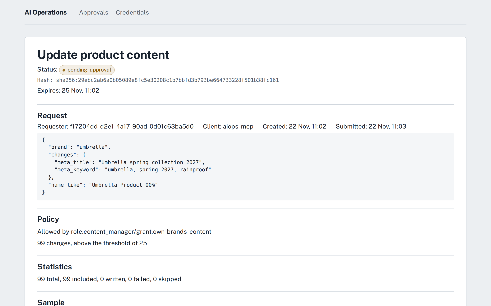
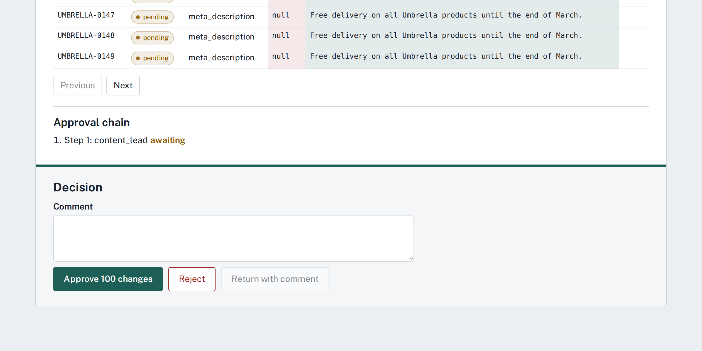
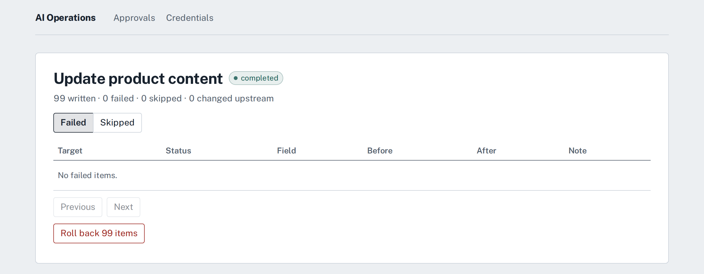
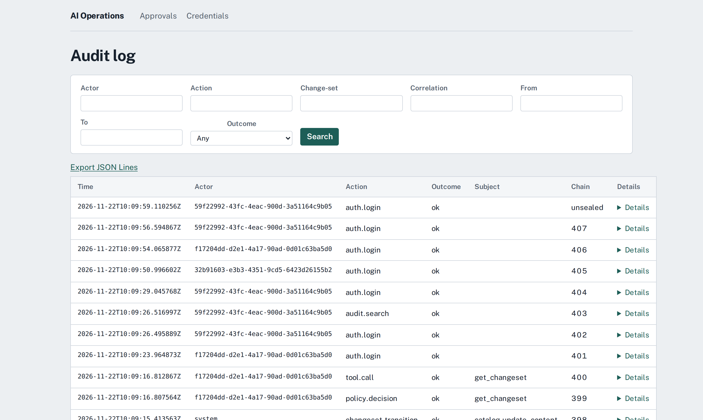
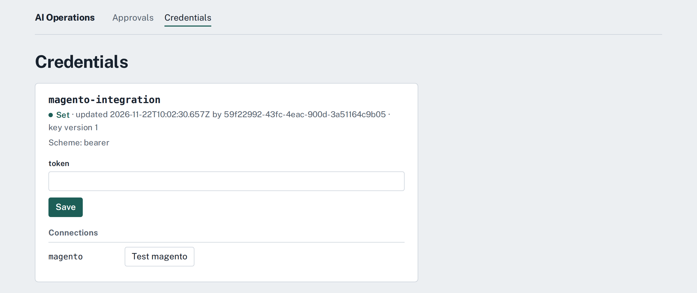

# AI Operations Layer

**Let people change business systems from an AI client, without trusting the model.**

[](https://github.com/serhii-f8/fde/actions/workflows/ci.yml)
[](LICENSE)


The AI Operations Layer is a self-hosted, open-source [MCP](https://modelcontextprotocol.io) server
that sits between AI clients such as Claude or ChatGPT and your company's systems. It decides who
may run which operation, turns every write into a reviewable change-set, waits for a person to
approve exactly that change-set, executes it durably, and records everything.



## Why

Connecting an AI client directly to a business system means handing it a token and hoping. The
model picks the tool, writes the arguments, and the write happens. Nobody reviewed it, nobody can
say exactly what changed, and nothing can undo it.

This server keeps the convenience and removes the hoping:

- **The model only translates.** It turns a request into a tool call. Permission checks, diffs,
  approval screens and execution are deterministic server code with no model in the path.
- **People approve a fixed artifact.** A write is prepared as an immutable change-set identified
  by a content hash. An approval applies to that hash and nothing else.
- **Credentials stay on the platform.** The AI client never holds a token for a business system.
- **Everything is on record.** An append-only, hash-chained audit log says who asked, who
  approved and what was written.

## How it works

```
 AI client                 AI Operations Layer                     Business system
 ─────────                 ───────────────────                     ───────────────
 "Update the meta    ──►   1. verify login and role
  titles of all            2. read current values        ◄──────   Magento, Gitea,
  Acme products"           3. store diff as change-set             any REST API,
                     ◄──      (nothing written yet)                any MCP server
 preview + link
                           4. a person approves that
 submit              ──►      exact change-set
                           5. durable workflow writes     ──────►
 result              ◄──      in batches, audits each step
                           6. rollback to recorded values ──────►  (if asked)
```

## Features

**Access control**
- OAuth 2.1 / OIDC login through Keycloak; roles mapped from groups.
- Default deny: an operation that is not granted is not even listed to the client.
- Grants constrain arguments (for example one brand only) and hide fields (for example cost).
- Service accounts for automation; their writes are still approved by people.

**Safe writes**
- Change-sets with a per-record diff, exclusion of records, CSV and XLSX export.
- Approval rules by record threshold and role, multi-step chains, no self-approval.
- Rollback to the values recorded before the write.

**Reliable execution**
- One Temporal workflow per change-set: survives restarts, retries with fencing, writes in batches.
- Opaque calls are sent at most once.

**Connect anything**
- Attach any REST API from its OpenAPI document, or any MCP server, without code.
- Pinned MCP tools: when an upstream changes a tool, calls stop until a person reviews it.
- Curated presets add preview, batching and rollback. Magento 2 catalog and Gitea issues ship in
  the repository, with a template for your own.

**Operations and security**
- Encrypted credential vault, egress limited to declared hosts, rate limits that fail closed.
- Health endpoints, OpenTelemetry traces, Prometheus metrics, structured logs.
- Configuration as code: YAML files applied as audited revisions, with `diff` and `explain`.
- Backup and restore scripts, forward-only migrations, multiple instances of each process.

## Screenshots

| | |
| --- | --- |
| **Approval queue**<br/> | **What the approver sees**<br/> |
| **Decision**<br/> | **Result with rollback**<br/> |
| **Audit log**<br/> | **Credential page**<br/> |

The same change-set and approval views are delivered as in-chat widgets to clients that support
MCP Apps. Other clients get text and a link to the page.

## Use cases

- **Bulk content changes in an online shop**: hundreds of products, reviewed and approved, with rollback.
- **Issue triage in a tracker**: label, close and comment in batches.
- **Read access for support staff**: one lookup operation, sensitive fields removed.
- **An existing MCP server behind approval**: choose its tools, pin them, add roles.
- **Automation that still needs a person**: a nightly job proposes, a person approves.
- **One controlled entry point**: one endpoint, one login, one audit log for every AI client.

Each is described in [Use cases](docs/guide/use-cases.md).

## Quickstart

You need Docker with Compose v2, 4 CPU cores and 8 GB of RAM.

```bash
git clone https://github.com/serhii-f8/fde.git ai-operations-layer
cd ai-operations-layer
cp .env.example .env   # optional: the defaults work when ports 8400, 8480, 17233, 15432, 8025 are free
docker compose up -d --build --wait
```

Then open <http://localhost:8400/app/approvals> and sign in as `dave` with the password
`dev-only-password`. The MCP endpoint is `http://localhost:8400/mcp`.

Every secret in `.env.example` is a development fake. Replace them all before real use: see
[Production hardening](docs/guide/production.md).

Continue with the walkthrough: [connect the Magento sandbox](docs/guide/connecting-magento.md),
[add a role](docs/guide/roles-and-approvals.md) and run
[your first bulk update](docs/guide/first-bulk-update.md) end to end, including approval and rollback.

## Documentation

| Understand | Install and try | Run it |
| --- | --- | --- |
| [Architecture](docs/guide/architecture.md) | [Installation](docs/guide/installation.md) | [Configuration reference](docs/guide/configuration.md) |
| [Using the server](docs/guide/usage.md) | [Connecting Magento](docs/guide/connecting-magento.md) | [Production hardening](docs/guide/production.md) |
| [Use cases](docs/guide/use-cases.md) | [Roles and approvals](docs/guide/roles-and-approvals.md) | [Operations](docs/guide/operations.md) |
| [Presets](docs/guide/presets.md) | [Your first bulk update](docs/guide/first-bulk-update.md) | [Backup and restore](docs/guide/backup-and-restore.md) |
| [MCP upstreams](docs/guide/mcp-upstreams.md) | [Service accounts](docs/guide/service-accounts.md) | [Upgrading](docs/guide/upgrading.md) and [versioning](docs/guide/versioning.md) |

The full index is in the [guide](docs/guide/README.md). A complete commented configuration is in
[examples/](examples/README.md).

## Technology

TypeScript on Node 22 · NestJS · official MCP TypeScript SDK · Temporal · PostgreSQL with Drizzle ·
Keycloak · React and Vite · Docker Compose. Two processes (`api`, `worker`) from one pnpm monorepo.

## Contributing

Contributions are welcome: new presets, adapters, documentation and fixes. Start with
[CONTRIBUTING.md](CONTRIBUTING.md) for the setup, the test layout and the commit rules, and read the
[code of conduct](CODE_OF_CONDUCT.md). A new preset needs no change to the server: copy
[examples/preset-template](examples/preset-template/README.md).

Report vulnerabilities privately as described in the [security policy](SECURITY.md).

## Changelog

See [CHANGELOG.md](CHANGELOG.md).

## Licence

Apache License 2.0. See [LICENSE](LICENSE) and [NOTICE](NOTICE).
