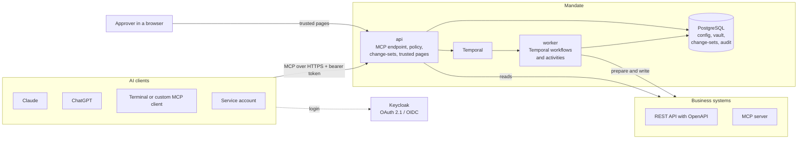
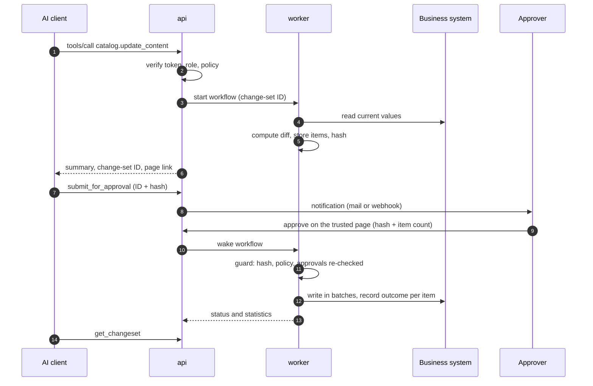
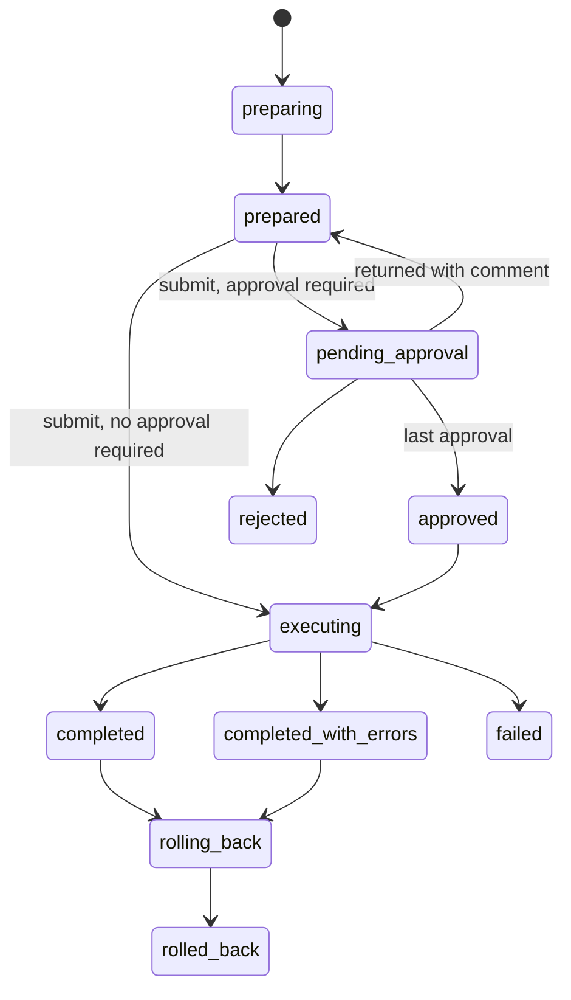

# Architecture

This page explains how Mandate is put together: the processes, what each one owns,
how a read and a write travel through them, and where the safety properties are enforced. Read it
before you operate the server in production or change its code.

## The idea in one paragraph

An AI client is good at turning a request into a tool call and bad at being trusted with your
business systems. The server takes the tool call and does everything that needs trust itself, in
deterministic code: it checks the caller's role, prepares a write as a fixed change-set with a
diff, waits for a person to approve exactly that change-set, executes it durably, and records every
step. The model never sees a credential and never decides what is allowed.

## Components



| Component | Kind | What it owns |
| --- | --- | --- |
| `api` | Process (NestJS) | The MCP endpoint `POST /mcp`, token verification, the tool list per caller, policy checks, change-set creation, the REST API and the static bundle of the trusted pages, the widget resources, the `mandate` command line |
| `worker` | Process (Temporal worker) | One workflow per change-set; activities that read current values, compute the diff, write batches, roll back, seal the audit chain and send notifications |
| `web` | Static bundle served by `api` | Trusted pages: approvals, change-set detail, credentials, audit |
| PostgreSQL | Infrastructure | Configuration revisions, encrypted credentials, change-sets and their items, approvals, the audit log, page sessions, rate counters |
| Temporal | Infrastructure | Durable execution: a workflow survives restarts of `api`, `worker` and Temporal itself |
| Keycloak | Identity provider | Login, groups, tokens bound to the MCP URL. Bundled as the default; any OIDC provider that issues the same claims can replace it |

Both processes are stateless and can run in several instances. Migrations are forward-only and
run on start under a lock.

## The path of a read

1. The client calls a tool on `/mcp` with an access token.
2. `api` verifies the token (signature, issuer, audience equal to the MCP URL) and maps the
   caller's groups to roles.
3. The tool must be in the caller's own tool list. An operation that no role grants is not listed
   and cannot be called.
4. The arguments are validated against the operation's schema, then the policy engine evaluates
   the grant: scope constraints on arguments, denied fields, rate limits.
5. `api` opens the connection's credential from the vault for this one call, calls the upstream
   system through the adapter, removes denied fields from the answer and returns it.
6. The decision and the call are written to the audit log.

## The path of a write



What matters in this sequence:

- **Nothing is written during preparation.** The worker reads the current values and stores a
  diff. The change-set gets a content hash (`sha256:...`) over its items.
- **A change-set is immutable once prepared.** Excluding items does not edit it: it derives a new
  change-set with a new hash and leaves the source untouched. Database triggers refuse any other
  change.
- **An approval names the artifact.** The page sends the hash and the item count the approver saw.
  An approval for one hash cannot apply to another change-set.
- **The worker checks again.** Before the first write, a guard recomputes the hash from the stored
  items and re-evaluates policy and approvals against the active configuration.
- **Execution is durable and fenced.** Batches are claimed with an attempt number; a submission
  that was recorded is never sent twice; every item ends `written`, `failed` or `skipped`.
- **Rollback uses recorded values.** A finished change-set can be rolled back within its window.
  The worker restores the `before` value of each item this run wrote and skips items that changed
  upstream in the meantime.

Read-only and low-risk operations skip the workflow: `api` checks policy, calls the adapter and
audits.

## Change-set lifecycle



A change-set that is not yet executing can also end `cancelled` (by the requester) or `expired`
(after `changesets.expire_after_hours`, 72 hours by default). Any transition not in the lifecycle is refused.

## How operations are attached

An **operation** is one tool the server offers, such as `catalog.update_content`. It belongs to a
**connection** (one upstream system with one credential) and is bound to the upstream in one of
three ways:

| Binding | What you write | What you get |
| --- | --- | --- |
| OpenAPI | A reference to an operation in the upstream's OpenAPI document | Reads, and writes prepared from a declarative manifest: which request reads the current values, how to diff, how to batch, how to restore |
| MCP upstream | The name of a tool on another MCP server, with a pin | Reads, and opaque writes that always need approval. The pin is a hash of the tool's definition: when the upstream changes the tool, calls stop until a person reviews and re-pins it |
| Code | A function in a preset package | Reads and per-record writes for APIs that do not fit a manifest |

A **preset** is a versioned package of curated operations for one system. Two ship with the
repository: `@mandate/magento2-catalog` (search, read and bulk content updates of Magento 2
products) and `@mandate/gitea-issues` (search, field updates, labels and comments on Gitea issues).
Presets use only the public connector SDK, so adding one needs no change to the server. See
[Presets](presets.md) and [MCP upstreams](mcp-upstreams.md).

## Trusted pages and widgets

The server has a deliberately small user interface: the approval queue, the change-set view, the
credential page and the audit log. The pages are served by `api` under `/app/` with a strict
content security policy and a server-side session.

The change-set and approval views are also built as MCP Apps widgets, so a client that renders
widgets shows the same components in the chat. A widget holds no authority: every button is a tool
call that goes through the same pipeline as any other. Clients that cannot render widgets get text
and a link to the page. Deciding in a widget is off unless a role allows it, and is never available
for destructive operations.

## Where each safety property is enforced

| Property | Enforced by |
| --- | --- |
| Default deny | The policy engine in `packages/core`; the tool list is built per caller |
| The model is not trusted | No model call anywhere in the server; upstream content is treated as data |
| Immutable change-sets, append-only audit and approvals | PostgreSQL triggers, in addition to the code |
| Tamper-evident audit | A hash chain sealed by the worker; `mandate audit verify` checks it |
| Credentials never leave the platform | AES-256-GCM envelope encryption in PostgreSQL; opened per call; scrubbed from logs, audit, tool results, workflow history and notifications; Temporal payloads are encrypted |
| The user's token is never forwarded upstream | Adapters authenticate with the connection's credential only |
| Egress control | Adapters call only the hosts a connection declares; private ranges are blocked and redirects are not followed |
| Abuse limits | Rate limits per client address, per user and per service account; limits fail closed |
| Fresh login for sensitive actions | Storing a credential and rolling back need a login within the last five minutes |

## Repository layout

```
apps/
  api/            MCP endpoint, REST API for the pages, command line
  worker/         Temporal workflows and activities
  web/            trusted pages (React)
packages/
  core/           domain model, policy, change-set lifecycle and hash; no framework
  db/             schema, migrations, repositories, credential vault
  config/         YAML schema, loader, revisions, preset packages
  connector-sdk/  public interface for presets and code operations
  adapters/       OpenAPI adapter, MCP adapter, guarded HTTP client
  upstream/       code shared by api and worker to reach upstream systems
  temporal/       workflow contract, payload encryption
  widgets/        shared React views, built as pages and as MCP Apps
  testing/        fakes, fixtures and contract suites
presets/          magento2-catalog, gitea-issues
deploy/           Dockerfile, Compose parts, Keycloak realm, sandboxes, backup scripts
examples/         a complete commented configuration and a preset template
```

Package boundaries are enforced by lint rules: `core` imports no framework, adapters import only
the connector SDK, presets import only public interfaces.

## Technology

TypeScript on Node 22, pnpm workspaces and Turborepo, NestJS, the official MCP TypeScript SDK
(Streamable HTTP, stateless), Temporal, PostgreSQL with Drizzle, Keycloak, React and Vite, YAML
configuration validated with Zod, Vitest and Testcontainers, Docker Compose.

## Background

- [Technical specification](../SPEC.md): every requirement with its identifier.
- [Decision records](../decisions/README.md): why each choice was made.
- [Temporal workflow conventions](../conventions/temporal-workflows.md).

## Next

[Using the server](usage.md) for the day-to-day view, or [Installation](installation.md) to run it.
