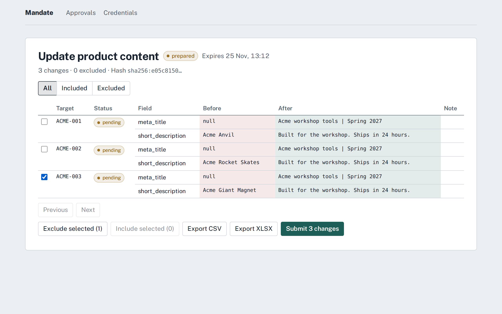
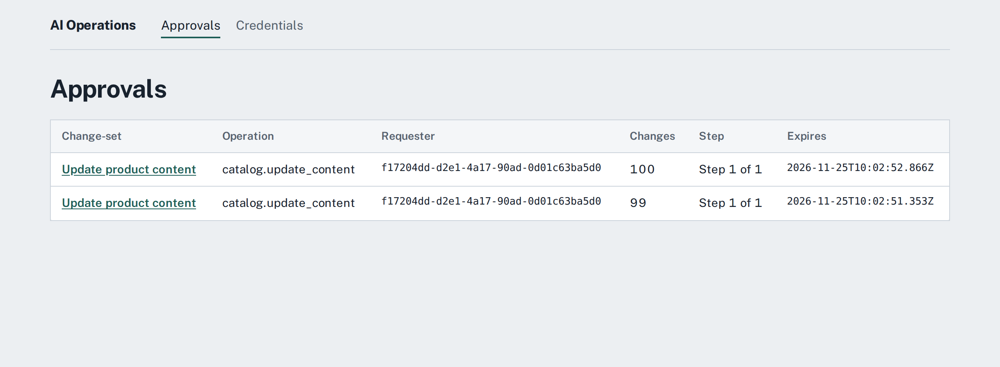
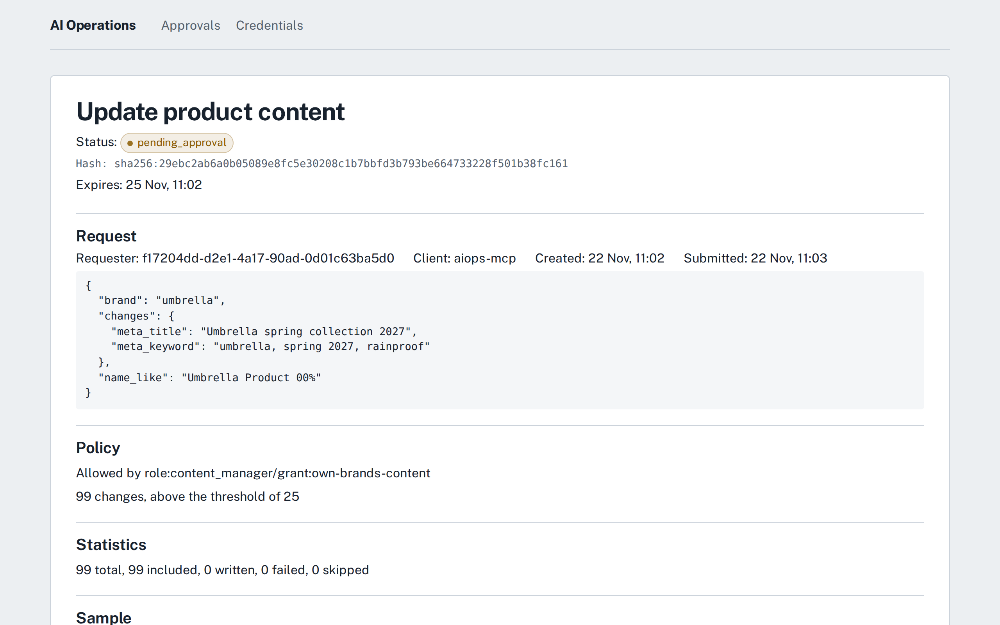
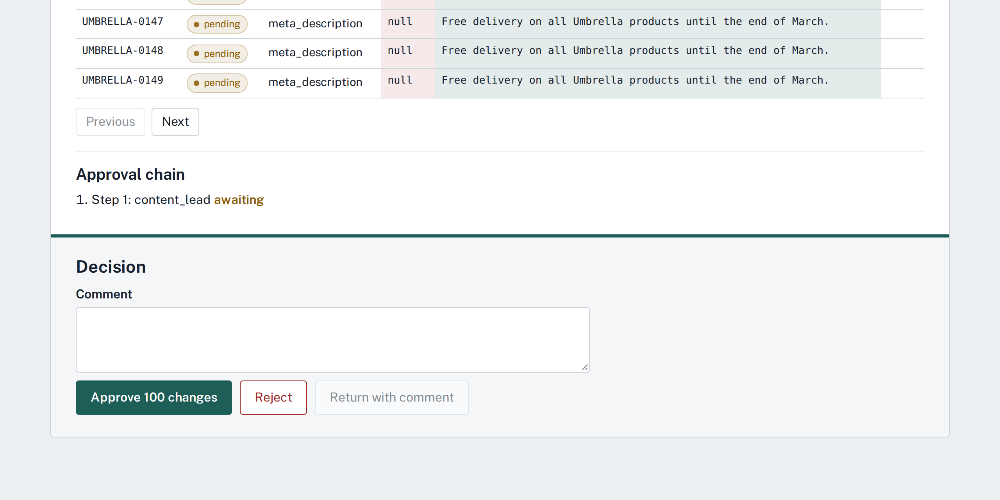
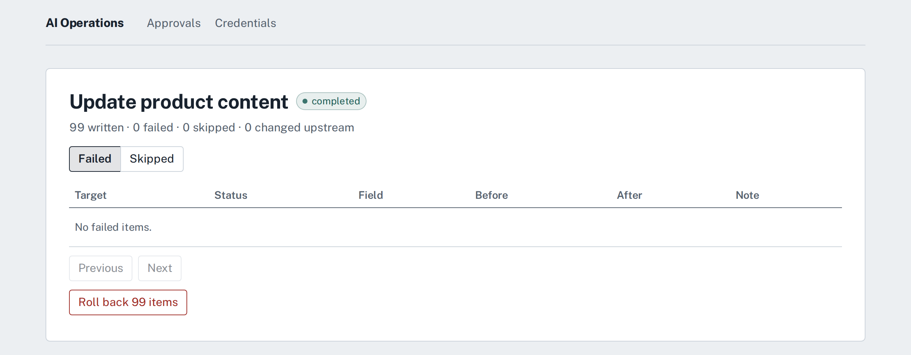
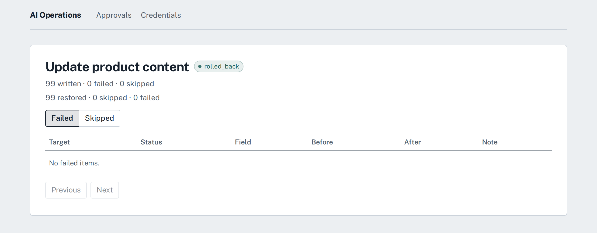
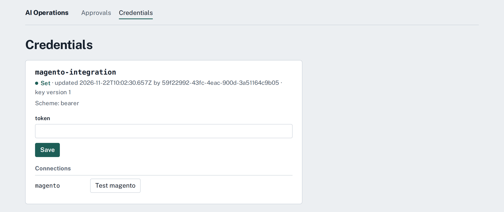
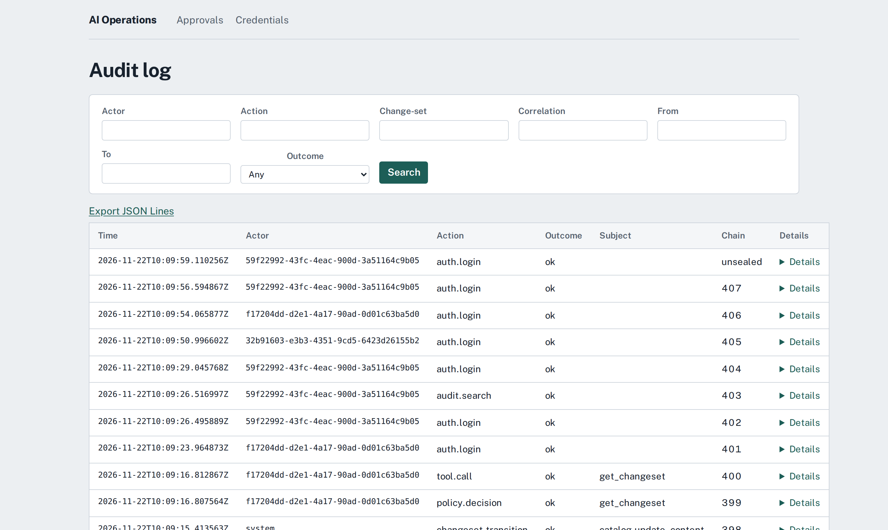

# Using the server

This page describes daily use for the three kinds of people who touch the server: the person who
asks for a change in an AI client, the person who approves it, and the administrator. It assumes a
running installation ([Installation](installation.md)). For a complete command-by-command run, see
[Your first bulk update](first-bulk-update.md).

## Connect an AI client

Every client connects to one URL: the MCP endpoint, `https://<your-host>/mcp`
(`http://localhost:8400/mcp` on the development stack). The client sends the user through the
Keycloak login once and then calls tools with the user's token.

| Client | How |
| --- | --- |
| Claude (claude.ai, Claude Desktop) | Add a custom connector with the MCP URL |
| ChatGPT | Add the MCP server with OAuth and the pre-registered client `mandate-mcp` |
| Scripts and CI | A [service account](service-accounts.md) with the client-credentials grant |
| Local testing | The reference terminal client in `tooling/acceptance/` |

Hosted clients need to reach the endpoint and Keycloak over public HTTPS. The exact settings are in
[Connect Claude or ChatGPT](first-bulk-update.md#connect-claude-or-chatgpt-optional).

## What a user sees

The tool list is personal. It contains the operations the user's roles grant, plus the built-in
tools below. An operation that is not granted is not listed and cannot be called.

| Built-in tool | What it does |
| --- | --- |
| `list_my_operations` | Lists the operations the caller may use, with their limits |
| `get_changeset` | Status, statistics and items of a change-set the caller may see |
| `submit_for_approval` | Submits a prepared change-set, named by ID and hash |
| `exclude_changeset_items` | Derives a new change-set without the named items |
| `cancel_changeset` | Cancels a change-set that has not finished |
| `rollback_changeset` | Says whether a rollback is possible and links to the page that confirms it |
| `create_plan` | Puts change-sets the caller prepared in an order, so each starts only after the one before it completed |
| `list_staged_files` | Where to upload a file and the files the caller has staged, with their IDs; shown only to roles that may stage files |
| `review_changeset` | For approvers: the data of a change-set awaiting their decision |
| `ping` | Checks the connection and the login |

## Ask for a change

A user asks in plain language, for example: *"Set the meta title of all Acme products to 'Acme
workshop tools | Spring 2027'."* The model turns this into a call of a write operation. The server
then:

1. checks that the user's role allows the operation for these arguments;
2. reads the current values from the business system;
3. stores the difference as a change-set and answers with a summary and a link.

Nothing has been written yet. The user opens the change-set, in the chat widget or on the page
`/app/changesets/<id>`, and sees every record with its value before and after:



From here the requester can:

- **exclude** records that should not change. The result is a new change-set with a new hash;
- **export** the items as CSV or XLSX to check them elsewhere;
- **submit** the change-set. If the role's approval rule does not require a person for a change of
  this size, execution starts at once. Otherwise the change-set waits for approval.

## Approve a change

Approvers can be told by mail or webhook (`notifications` in the configuration), and find waiting change-sets in the queue at
`/app/approvals`:



The change-set page is rendered by the server from what it stored, never from text a model wrote.
It shows the original request, the rule that allowed it, the reason approval is needed, the
statistics, a random sample of items and the full item list:



At the bottom the approver decides. **Approve** sends the hash and the item count the approver
saw, so the approval applies to exactly this change-set. **Reject** ends it. **Return with
comment** sends it back to the requester.



Rules that always hold:

- A requester never approves their own change.
- Each step of the approval chain needs a member of the role that step names.
- A service account never approves.
- Deciding from the in-chat widget is off unless the role sets `approval.allow_widget`, and is
  never available for destructive operations.

## Follow the result

After the last approval the worker writes the change in batches. The requester follows it with
`get_changeset`, in the widget, or on the page. When it finishes, the result shows how many records
were written, failed or skipped, and lists the ones that need attention:



## Verify after

Some systems accept a write at once but show it later: a search index that refreshes every few
minutes, a cache, a queue that applies the change in the background. An operation can therefore
declare a verify-after stage (`verify_after` in its manifest, see the
[configuration reference](configuration.md)). The platform then does not call the change finished
when the last batch was sent. It looks at the written records again, read-only, until the checks
the administrator wrote hold for them or a time limit passes.

What you see:

- While it runs the change-set is still `executing`, and the result reads `Verifying: N of M
  confirmed`. A written record is `confirmed` once all checks hold for it.
- When every record is confirmed the change-set ends `completed`. A record that the checks did not
  confirm before the time limit is `unconfirmed` and shows `Not confirmed: <check title or code>`.
  It stays `written` (the write was sent and is not undone), it can be rolled back, and the
  change-set ends `completed_with_errors`. The code is that of the first check that failed at the
  last look, or one of three fixed codes: `verify_read_failed` (the system could not be read, or
  answered incompletely; a record is never confirmed on an answer that was not read),
  `verify_timeout` (the time ran out without a look that named a failing check) and
  `verify_cancelled`.
- Only a status and a code are stored and shown for each record, never a value that was read.
- The result lists the records that are not confirmed (still pending or `unconfirmed`) on a tab of
  their own, **Not confirmed**, which it opens on when no record failed. `get_changeset` takes
  `verification: not_confirmed` (or `pending`, `confirmed`, `unconfirmed`) to page through the same
  list, and so does the page's items list (`?verification=not_confirmed`). While verification runs,
  `get_changeset` says "is executing, verifying: N of M confirmed".

Things to know when you run it:

- A change-set that is verifying holds one of the `limits.concurrent_executions` slots until it
  ends, as it does while it writes. Long verifications can delay other change-sets from starting.
- A rollback waits until verification ends.
- Cancelling a change-set during verification stops the verification. Records not yet confirmed
  become `unconfirmed` with `verify_cancelled`, and the change-set ends with the status its records
  give (`completed` or `completed_with_errors`), not `cancelled`.
- Verification reads the upstream system: roughly looks x items / batch size reads, where looks is
  at most `(timeout_seconds - after_seconds) / every_seconds`, and more when the checks use lookups
  of their own. Choose `every_seconds` and `timeout_seconds` with the rate limits of that system in
  mind.
- The time limit is counted from the end of the last batch and stored when verification begins. A
  restart of the worker does not move it.

## Plans

Some changes need several change-sets that must run in a fixed order: create the records, then link
them, then publish them. A plan puts change-sets in that order. It does not merge them: each step is
still its own change-set with its own hash, approval, workflow and result.

**Create a plan.** The requester prepares the change-sets first, then calls `create_plan` with a
title and the change-set IDs. The order of the list is the order of the steps.

- A plan has 2 to 20 steps. Every change-set must be one the caller prepared, still `prepared` (not
  yet submitted), not expired, in no other plan, and listed once. A call that breaks one of these
  rules is refused and writes nothing.
- The title is text of 1 to 200 characters, without control characters. It is shown to the approvers of every step of the
  plan, so keep it free of anything they should not see.

**Approval stays per change-set.** An approver approves exactly the hash of the step in front of
them, and steps can be approved in any order. Approving step 3 early is safe: it cannot start before
step 2 is done.

**Order is enforced at the start.** A step above the first cannot start until the step before it is
`completed`: no record failed and, with a [verify-after stage](#verify-after), none is
unconfirmed. A start that comes too early is refused with `plan_blocked` and changes nothing: the step stays
`prepared` or `approved`.

**The next step starts by itself.** When a step ends `completed`, the platform starts the next step
if it is `approved`. It does so on the requester's behalf, with the limits of the requester's role.
Things to know:

- A next step that is only `prepared` is never started by the platform, even if its operation needs
  no approval. Nobody confirmed it; the requester submits it as usual.
- If a limit refuses the start (for example `limits.concurrent_executions`), the step stays
  `approved` and the requester or the approver can start it later.
- If the platform cannot reach Temporal to start it, the next step ends `failed` with
  `executor_unavailable`, as when an approver's start meets the same failure, and the plan stops.

**Skipped records do not stop a plan.** A step whose records were skipped, because they changed
upstream since preparation (`drift`) or are gone, still ends `completed` when nothing failed, and
the next step starts. Check a step's skipped count before you rely on what it should have changed;
if a skipped record matters to a later step, cancel that step.

**A step that does not complete stops the plan.** A step that ends `completed_with_errors`, `failed`,
`cancelled`, `rejected`, `expired` or `rolled_back` leaves every later step blocked. There is no
override. The later steps expire, or the requester cancels them; after the cause is fixed, prepare a
new plan.

**Expiry is per change-set.** An approved step that waits behind a long step can expire
(`changesets.expire_after_hours`, 72 hours by default) before its turn. Set `expire_after_hours` for
the whole plan, not for one step.

**Rollback goes backwards.** A step cannot be rolled back while a later step is `executing` or
`rolling_back`, or while a later step wrote records that were not rolled back (it is not
`rolled_back`). Such a request is refused with `plan_order`. To undo a plan, roll back the last step
that wrote something first. A later step that started but wrote nothing (refused by the execution
guard, every record failed or was skipped, cancelled before its first batch, or ended
`executor_unavailable`) has nothing to undo and does not hold up the earlier step.

**Excluding items from a step.** Deriving a change-set from a plan step that is still `prepared`
(to exclude items) puts the derived change-set in the step's place once it is prepared; the source
leaves the plan. Derived from a step in any other status, the new change-set is outside the plan and
the source keeps its place.

**What a plan cannot do.** Every step is prepared before the plan exists, from the state of the
system at that time. A step whose preparation depends on the effect of an earlier step, such as
updating a record that an earlier step creates, cannot be in a plan, because the record is not
there to read yet. Fold the update into the create, or prepare that step after the earlier step ran
and run it outside a plan. A step whose stored `before` values went stale because an earlier step
changed the same fields is skipped as `drift`, like any change-set.

**See it.** `get_changeset`, the change-set page, the approval page and the widgets show "Step N of
M in plan ...", the status of every step and one line about the start: "Runs after step N completes
(now: ...)" while the step before it can still complete, "Blocked: step N ended ...; this step cannot
start" once it ended any other way (there is nothing left to approve it for), and "Ready to start"
for an approved step whose predecessor completed. An approval given before the step's turn answers
that the step will start when the step before it completes. A step's row shows only its number, ID, operation and status; opening another step
needs your own right to it. Plans need migration `0017`; see [Upgrading](upgrading.md#upgrading-to-130).

## Roll back

A finished change-set can be rolled back while its window is open
(`changesets.rollback_window_hours`, 168 hours by default). The requester confirms on the page
after a fresh login. The worker restores the value recorded before the write for every record it
wrote, and skips records that somebody changed upstream in the meantime.



## Administer

Administration is done with files and a command line, not an admin panel.

**Configuration.** Roles, connections, operations and limits are YAML files. You edit them, review
the difference and apply it as a new revision. The running processes follow within seconds:

```bash
docker compose exec -T api node dist/cli.js config diff /etc/mandate/config
docker compose exec -T api node dist/cli.js config apply /etc/mandate/config --actor <your name>
docker compose exec -T api node dist/cli.js config explain --operation <operation> --groups <group> --args '<json>'
```

`config explain` answers "would this group be allowed to make this call, and would it need
approval?" without calling anything. See [Roles and approvals](roles-and-approvals.md) and the
[Configuration reference](configuration.md).

**Credentials.** The credential of a connection is entered on the page `/app/credentials` by a
person whose role manages it, after a fresh login. It is stored encrypted and is never shown
again. The same page tests the connection:



**Staged files.** An operation that declares file arguments takes a file the person staged first,
not its bytes. `POST /api/v1/files` on the trusted page API (page session, `Origin` and CSRF token)
takes the raw bytes as the body, the declared type as `Content-Type` and the percent-encoded UTF-8
name in `X-File-Name`. It is open to a user with a role that grants such an operation (otherwise
403 `forbidden`) and answers 201 with `{ id, name, mediaType, size, sha256, preview, createdAt,
expiresAt }`. Refusals: 400 `invalid_name`, `invalid_media_type`, `empty_file`; 413
`payload_too_large` (above `files.max_bytes`); 409 `quota_exceeded`. `GET /api/v1/files` lists the
user's own files that still have content.

To use a staged file, the person uploads it on `/app/files` and the model passes its ID, a UUID, as
the value of the file argument (for example `{ "image": "<id>" }`). `list_staged_files` answers the
upload page URL and the caller's own staged files, so the model can find the ID after the upload. A
file that is unknown, someone else's or purged is refused with the path of the argument and
`file_not_found`; a file above the operation's size limit or of a type it does not allow is refused
with `file_too_large` or `file_type_not_allowed`. Nothing is created in any of these cases, and the
change-set that is created shows the file's name, type, size and hash, not its bytes. The upload is audited as `file.staged` with its size,
type and hash, never the name or the content. The body is stored as sent: a `Content-Encoding`
other than identity is refused with 415.

**Audit.** Every login, policy decision, tool call, approval, batch and configuration change is in
the audit log at `/app/audit`, for roles with `view_audit`. The log can be filtered by actor,
action, change-set, correlation ID, time and outcome, and exported as JSON Lines. Rows are hash
chained; `mandate audit verify` checks the chain.



**Operations.** Health endpoints, metrics, traces, credential rotation and backups are covered in
[Operations](operations.md), [Backup and restore](backup-and-restore.md) and
[Production hardening](production.md).

## When a call is refused

A refusal always names its reason, and is audited. The common ones:

| Reason | Meaning |
| --- | --- |
| The tool is not in the list | No role of the user grants the operation |
| `out_of_scope` | The arguments are outside the grant's scope, for example another brand |
| `rate_limited` | The caller or the address exceeded its limit; retry after the time given |
| `upstream_changed` | A pinned MCP tool changed upstream and needs a review |
| Hash mismatch | The change-set named is not the one the caller saw; read it again |

## Next

[Use cases](use-cases.md), or the walkthrough [Your first bulk update](first-bulk-update.md).
